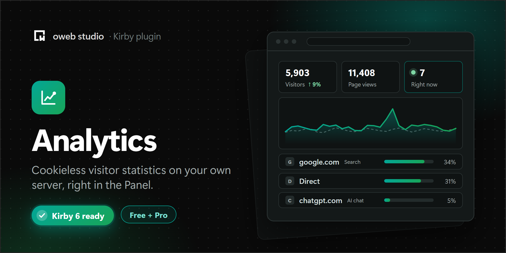

# Analytics for Kirby

[](https://market.owebstudio.com/checkout/buy/2b5ebedd-a30c-48d5-9142-7adaea60bdfe)

Visitor statistics for your Kirby site, counted on your own server and shown right in the Panel. No cookies, no IP addresses in the database, no third-party service.

Analytics is free (MIT). Analytics Pro adds goals and events, campaigns, countries, a live view, period comparison, the full history, email reports and CSV export.

## Requirements

- Kirby 6
- PHP 8.3 or newer with the `pdo_sqlite` extension (it is part of almost every PHP installation)

## Installation

1. Download the latest release
2. Unzip downloaded file
3. Copy/paste unzipped folder in your `/site/plugins` folder

Or with Composer:

```
composer require owebstudio/kirby-analytics
```

## Setup

There is nothing to set up. After the installation, every page view is counted on the server and shows up in the Panel under **Analytics**.

- Page views of logged-in Panel users are not counted. Open your site in a private window to see your own visit.
- Pages from Kirby's page cache are counted too.
- Pages from a static cache (Staticache, a CDN, nginx) never reach PHP. For those, add the script (see below) and set `'mode' => 'script'`.

## How visitors are counted

Analytics tells visitors apart with a hash of the IP address, the browser's user agent and the host, salted with a random value that changes every day. The salt of the previous day is deleted at midnight, together with the visitor hashes. What remains are daily totals: visitors, page views, sources, devices and so on.

- No cookies, no local storage, no fingerprinting script.
- The IP address and the user agent are only used in memory for the hash, the bot check and the device type. They are never stored.
- A person is one visitor per day. Over 30 days, someone who comes on 3 days counts as 3 visitors. Plausible works the same way.
- A visit ends after 30 minutes without a page view, or when the visitor comes back through another campaign or another site.
- Bots, crawlers, prefetch requests, logged-in Panel users and requests with `DNT: 1` or `Sec-GPC: 1` are not counted.

## Privacy

Analytics is designed to collect as little as possible, but it still processes IP addresses for a moment, which is personal data under the GDPR. Many sites rely on legitimate interest for this kind of measurement, and several data protection authorities exempt privacy-friendly audience measurement from consent (for example the French CNIL, under conditions). Others read the ePrivacy rules more strictly, especially when a script runs in the visitor's browser.

We don't claim that no consent is needed in every country. Mention Analytics in your privacy policy and check the rules that apply to your site. If you need consent, use the `consent` option.

Text for your privacy policy (adapt it to your site):

> We count visits to this website with a self-hosted statistics tool. It does not use cookies and does not store IP addresses. To tell visitors apart within one day, it uses a hash of the IP address and the browser, combined with a random value that is deleted every night. After that, only daily totals remain (for example how many people visited a page and from which website they came). The data never leaves our server.

## Options

All options are optional.

```php
// site/config/config.php
return [
    'owebstudio.analytics' => [
        // 'server' counts on the server, 'script' with the script (for static caches)
        'mode'       => 'server',
        // SQLite file, default: site/logs/analytics.sqlite
        'database'   => null,
        // days to keep daily totals, null keeps them (visitor hashes are always deleted daily)
        'retention'  => null,
        // count logged-in Panel users too
        'panelUsers' => false,
        // skip visitors with Do Not Track or Global Privacy Control
        'respectDnt' => true,
        // count only with consent, e.g. a cookie your consent banner sets
        'consent'    => fn ($kirby) => ($_COOKIE['consent'] ?? null) === 'yes',
        // never count these
        'ignore'     => [
            'paths'     => ['shop/checkout/*'],
            'templates' => ['error'],
            'ips'       => ['203.0.113.0/24']
        ],
        // the visitor's IP behind a proxy, e.g. Cloudflare
        'ip'         => fn ($kirby) => $kirby->request()->header('CF-Connecting-IP'),
        // path of the script's endpoint
        'endpoint'   => '_analytics',
        // file extensions the script counts as downloads
        'downloads'  => ['pdf', 'zip', 'docx', 'xlsx', 'pptx', 'csv', 'mp3', 'mp4'],
        // milliseconds to wait for a locked database before a hit is dropped
        'timeout'    => 200,
        // send the response before counting (PHP-FPM)
        'flush'      => true,
        // sender of the email reports (Pro), default: no-reply@ your domain
        'email'      => ['from' => 'analytics@example.com'],
        // show the Free version on a local or staging site, e.g. to test it
        'tier'       => null
    ]
];
```

## The script (optional)

About 1 KB, inline, no cookies. Add it before `</body>`:

```php
<?php snippet('analytics/script') ?>
```

It is only needed for statically cached pages (`'mode' => 'script'`) and for events. It sends the page, the referrer and event names, nothing else. With a Content Security Policy, pass your nonce: `snippet('analytics/script', ['nonce' => $nonce])`.

Once the script is on your pages, these events are counted automatically:

- **Outbound links**: `Outbound: example.com`
- **Downloads** (pdf, zip, docx and more): `Download: press-kit.pdf`
- **Form submits**: `Form: contact` (from the form's `data-analytics`, `name` or `id`; `data-analytics="false"` skips a form)

Your own events:

```html
<button data-analytics="Newsletter signup">Sign up</button>
```

```js
kirbyAnalytics.track("Booked a tour");
```

```php
// e.g. in a form controller, works without the script
analytics()->event('Order placed');
```

Events and campaigns are counted in the free version too. Analytics Pro shows them in reports.

## In the Panel

- The **Analytics** area with Overview, Pages and Sources (and Goals and Live in Pro)
- An **analytics** view button with the page's visitors of the last 30 days. Add it to a page blueprint, or to all pages at once:

  ```yaml
  # site/blueprints/pages/note.yml
  buttons:
    - open
    - preview
    - analytics
    - settings
    - status
  ```

  ```php
  // site/config/config.php
  'panel.viewButtons.page' => ['open', 'preview', 'analytics', 'settings', 'languages', 'status'],
  ```

- Reports for Kirby's `stats` field:

  ```yaml
  fields:
    analytics:
      label: Last 30 days
      type: stats
      size: small
      reports: page.analytics.reports   # or site.analytics.reports
  ```

- Permissions: the area can be hidden per role (`access.analytics`). Deleting data, goals and email reports need `owebstudio.analytics.manage` (on by default).

## In templates

```php
// the 5 most visited listed pages of the last 30 days
foreach (analytics()->data()->popular(5) as $item) {
    echo $item->title();
}

$page->analytics()->views();      // page views, last 30 days
$page->analytics()->visitors(7);  // visitors, last 7 days
```

## Analytics Pro

- **Goals and events** with conversion rates, plus page visit goals (`/contact/thanks`)
- **Campaigns** from `utm_source`, `utm_medium` and `utm_campaign`, with conversions
- **Countries** from a local database: the IP address never leaves your server
- **Live**: visitors, pages and sources of the last 5 minutes
- **Compare periods** in the chart and in every table
- **Full history**: 90 days, 12 months, all time and custom ranges
- **Email reports**, weekly or monthly, with your site's own email setup
- **CSV export** of every table

Your data is counted from day one, so Pro shows the full history as soon as you activate it.

Pro needs a license key on live sites: [buy a license](https://market.owebstudio.com/checkout/buy/2b5ebedd-a30c-48d5-9142-7adaea60bdfe) (€39.99, up to 3 sites, updates for life), then open the Panel's System view, click "Free" next to Analytics and enter the key. On local and staging sites Pro works without a key.

### Countries

In the tracking status (Analytics, `…` menu), download the free [DB-IP IP to Country Lite](https://db-ip.com/db/download/ip-to-country-lite) database (CC BY 4.0). This sends one request from your server to db-ip.com, without any visitor data. You can also use any MaxMind DB file, for example GeoLite2 Country:

```php
'owebstudio.analytics.geoip' => '/path/to/GeoLite2-Country.mmdb',
```

### Email reports

Choose the frequency and the recipients in the Panel (Analytics, `…` menu). Reports are sent with your site's [email setup](https://getkirby.com/docs/guide/emails). For exact timing, run this from cron every hour:

```
kirby analytics:report
```

Without cron, the first page view after the time sends the report.

## Performance

Every page view is one short SQLite transaction after the response was sent (with PHP-FPM, the visitor doesn't wait for it). If the database is busy for longer than `timeout`, the hit is dropped instead of slowing the page down.

## License

Analytics is MIT. Analytics Pro (the `lib/Pro` and `src/pro` folders) is under the [oweb studio Commercial License](https://github.com/owebstudio/.github/blob/main/LICENSE.md). See [LICENSE.md](LICENSE.md).
